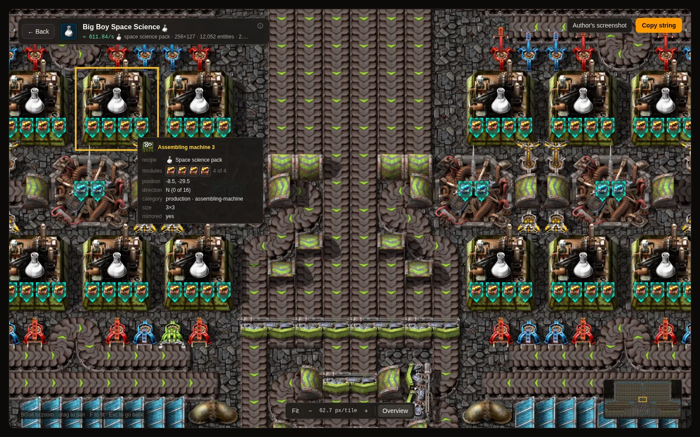
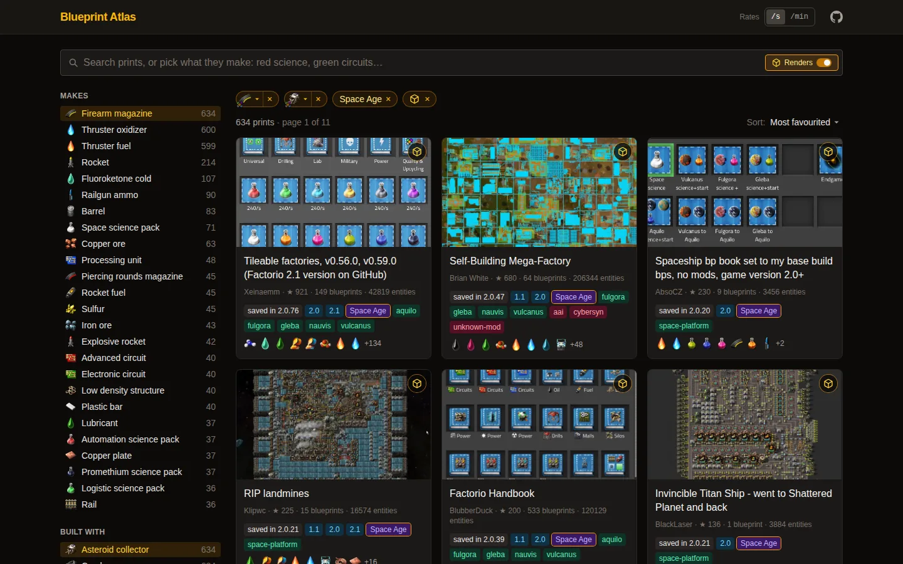
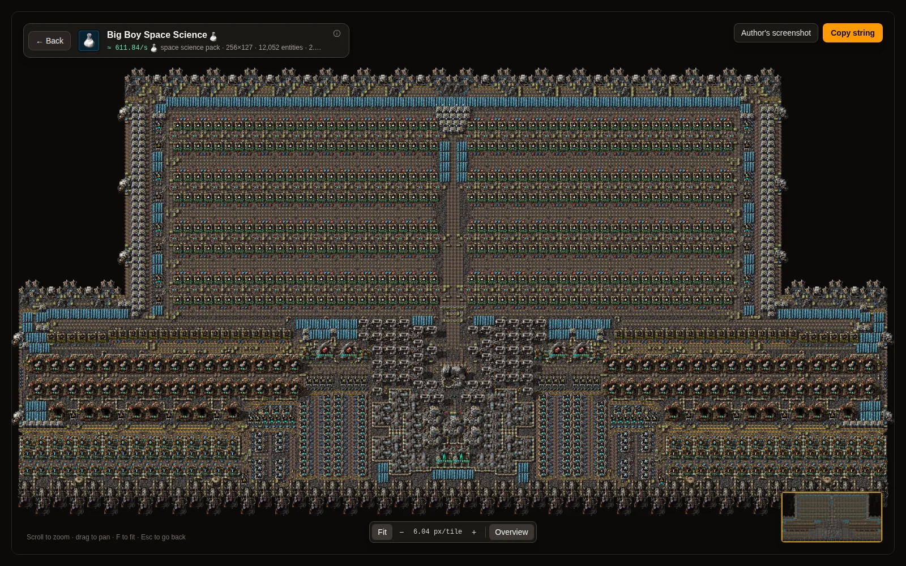
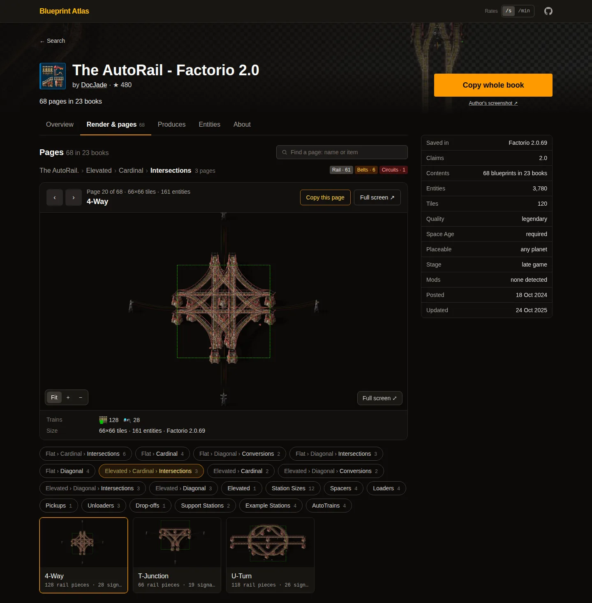
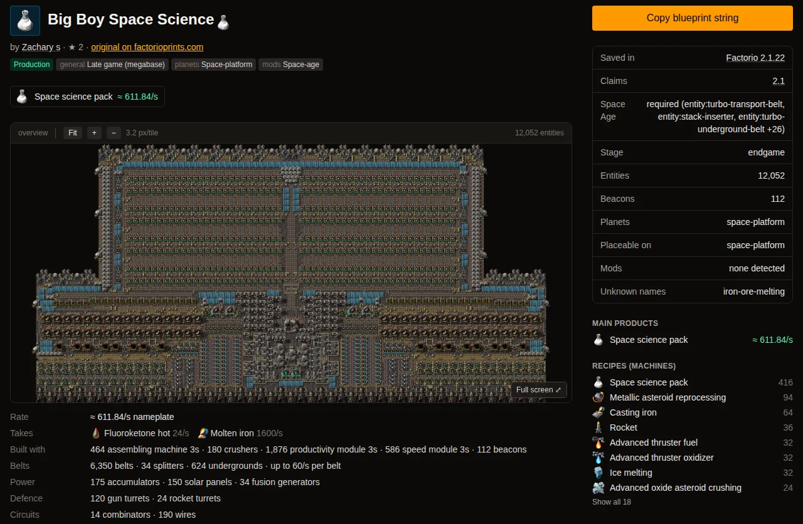

# Blueprint Atlas

**Find Factorio blueprints by what they actually do, and view each blueprint's high-res render.**
Blueprint Atlas is a searchable index of the blueprints shared on
[factorioprints.com](https://factorioprints.com). Every blueprint string is decoded and analysed,
and the blueprints are drawn as high-resolution in-game renders you can pan and zoom, down to
every inserter, belt and module.



<sub>[Big Boy Space Science](https://factorio.menzies.io/prints/-P4BtyxSn1soAT9w849N) by Zachary s, a
12,052-entity space science build, zoomed in to the game's full sprite resolution. Hovering a
machine shows its recipe, modules, size and direction.</sub>

## Features

### Search by what's inside

Filter by what a print makes, the buildings, recipes and modules it uses, game version, Space Age,
planets, mods, circuits and trains, all read from the blueprint itself. Makes, buildings and
modules can carry a quality ("legendary beacons", "processing units crafted at rare or above").
Filters stack, so each click narrows the results, and community nicknames ("red science", "gc")
work as search text.



### High-res game renders

Every page saved in Factorio 2.0 or later, plus the 1,000 most-favourited prints, drawn with the
game's own sprites. See the whole build, zoom in to 64 px per tile, and hover any entity for its
recipe, modules and connections.



### Books you can navigate

The selected page's render first, then every book and sub-book, with a thumbnail of each page's
render so you can find the one you want by looking. Copy the whole book, or just the page you're
looking at.



### Calculated rates

No rate in the description? It's worked out from the page's machines and recipes, with their
modules and beacons, so you see what a build makes with every machine crafting at full speed, per
second or per minute.



Every print links back to its page on factorioprints.com and credits its author. Authors'
screenshots are served from the site's own copies of their Imgur uploads, so they load where Imgur
is blocked.

## How it works

```
GitHub mirror of factorioprints (motlin/factorio-blueprint-firebase-cdn, one JSON file per print)
  → sanitize      drop fields the site doesn't use, such as `favorites` (user ids)
  → decode        exchange string: "0" + base64 + zlib, with a cap on inflated size
  → analyse       walk books and pages: outputs, inputs, recipes, entities, rates, versions,
                  Space Age, planets, mods, circuits, trains (data/game/game-data-2.1.23.json)
  → store         D1: a slim search index, about a dozen rows per print
                  R2: the sanitised record, the analysis document, the page list and per-page strings
```

- **Pipeline:** `src/lib/server/pipeline/`, written with [Effect](https://effect.website) as
  services (`PrintSource`, `RawStore`, `PrintRepository`). The same code runs in the Worker, in
  `bun run ingest` and in `bun run backfill`. Re-runs skip prints whose content hasn't changed.
- **Search:** one FTS5 table. Besides title, description, labels, entities, recipes and community
  nicknames ("red science", "gc"), each print has a `facets` column of keyword tokens
  (`makes_item_automation_science_pack`, `v_2_0`, `sa_yes`, `uses_entity_foundry`…), so free
  text and every filter resolve in a single FTS match. Sidebar counts come from a precomputed
  `facet_counts` table when unfiltered and are counted exactly over the matches otherwise.
  Filters that take several values (`makes`, `takes`, `uses`, `recipe`, `module`, `version`,
  `tag`) stack: `?makes=a&makes=b` matches prints that make both.
  Each print's author name is a column too, and `?author=<id>` is a `by_<id>` token; names come
  from the `authors` table (`bun run authors`).
  "Only prints with a render" (`?render=1`) is the `render_yes` token, set from the
  `print_renders` table by `bun run render:flags`, so a re-ingest keeps it.
  "Popular this month" (`?sort=popular`) orders by `prints.views_30d`: each print page sends one
  request (a keepalive `fetch`), the Worker writes an Analytics Engine data point holding only the print id (no IP,
  user agent or cookie), and a daily scheduled Worker (`src/cron/views.ts`) totals the last 30
  days into D1 (`bun run views:sync` does the same by hand).
- **Print pages** read only the print's R2 analysis document, never D1.
- **Page cache:** search and print pages are kept in each Cloudflare location's cache, under keys
  that hold the build and a data version in D1, so a deploy or any data change (ingest, render
  flags, views, author names) shows at once and old entries just expire.
- **Game renders:** `bun run render` draws in-game-looking images of each blueprint page offline
  with [fpsr](https://github.com/rickyzhangca/fpsr), from sprite assets built from an installed
  Factorio (`FPSR_ASSETS_DIR`). Each page gets an AVIF overview, AVIF map tiles at 16, 32 and
  64 px per tile where they are sharper than the overview (named by pixel hash, so identical
  tiles are stored once per print), a sidecar, and its entity data for hover details (entities,
  recipes, modules, belt and pipe connections). Output goes to `data/renders/` on local disk (or `RENDERS_DIR`),
  which `bun run dev` serves; with `--upload local|prod` each finished page also goes into a
  RENDERS bucket while the run goes on (the local one, or the deployed one through R2's S3 API),
  its tiles, overview, entity data and sidecar before the print's `index.json`, so the site never
  links to a file that isn't up, and a restart sends only what didn't make it. Runs are a durable queue in the local D1 (`render_runs`,
  `render_jobs`): a page is redrawn only when its blueprint, the assets or the render settings
  change, worker processes with a timeout and memory cap keep a bad page from stopping the run,
  and a stopped or killed run resumes where it left off. A page starts only while the workers'
  memory fits `--mem-budget-mb` and, on Linux, the machine keeps `--mem-reserve-mb` free
  (default the larger of 2 GB and 10% of RAM) beside what the pages in flight may still grow;
  workers are the kernel's first choice if memory runs out anyway, so a worker is killed and its
  page retried, never the run. Pages that use entities or tiles fpsr has
  no sprites for (mods) are skipped, and so are pages saved before Factorio 2.0, except in the
  most-favourited prints (`--top N`), whose older pages fpsr migrates and draws too. The viewer
  (Canvas2D, pan and zoom) shows the renders; pages without one have no viewer. Deployed, render
  images are served from the renders bucket's own hostname through Cloudflare's cache (or by the
  Worker without one); see docs/deploy.md, "Edge cache". Once a print's pages are drawn (or found
  unchanged), the run also brings its page thumbnails up to date: each overview at its own aspect,
  with transparency, as AVIF at up to three sizes (`<page>.<stamp>.t320|t640|t960.avif` plus a
  `thumbs.json` listing them, in `data/thumbs/` or `THUMBS_DIR`), made in the run's own process and
  uploaded after the print's render files; `bun run render:thumbs` does the same for any prints on
  its own. Sprite atlases and renders are never committed.
- **Icons:** the game's own icons (items, fluids, recipes, entities, signals, tiles, planets…),
  exported with Factorio's `--dump-icon-sprites` and turned into one 64 px WebP each by
  `bun run icons`. They live in one R2 bucket, shared by every stage, under a content-hashed path, served from its own
  hostname through Cloudflare's cache (or by the Worker at `/sprites/…` without one). Pages send
  only the icons they show, and one component draws them (`src/lib/components/Icon.svelte`).
  Icons aren't in the repository; without them, icons are blank slots.
- **Admin:** `/admin/pipeline` shows backfill runs live (progress, failures, pause, resume, stop),
  and `/admin/render` shows render runs (progress, rate and ETA, latest renders, skipped and
  failed pages, uploads, pause, resume, stop); under `bun run dev` it can also start a batch or
  resume the last run on this machine. They're open under `bun run dev`; deployed, they require
  Cloudflare Access (see docs/deploy.md).

Stack: SvelteKit 3 on Cloudflare Workers (`@sveltejs/adapter-cloudflare`), D1, R2, Effect 4, bun,
Tailwind 4. Deploys use [Alchemy](https://alchemy.run).

## Requirements

- [mise](https://mise.jdx.dev) (installs the bun and Node versions in `mise.toml`), or bun 1.4.3
  and Node 26 on your PATH. Node is needed by wrangler's remote bindings.
- No Cloudflare account for local development: D1 and R2 run under miniflare in `.wrangler/state`.
- Only for making icons and renders: an installed Factorio, `cwebp` (libwebp) on PATH for
  `bun run icons`, and fpsr's sprite assets built from the game (`FPSR_ASSETS_DIR`) for
  `bun run render`.

## Local setup

```sh
mise install
bun install
bun run db:migrate                          # create the local D1 database from migrations/
bun run backfill --stage local --limit 50   # load 50 real prints from the GitHub mirror
bun run dev                                 # http://localhost:5173
```

`--limit N` picks N prints spread evenly by size across the mirror. Leave it out to load every
print (about 18,000; this takes a while and a few GB of local R2). No print data is included in
this repository.

## Commands

| Command                                                        | What it does                                                                                                                                                                                                                                         |
| -------------------------------------------------------------- | ---------------------------------------------------------------------------------------------------------------------------------------------------------------------------------------------------------------------------------------------------- |
| `bun run dev`                                                  | Vite dev server with local D1 and R2                                                                                                                                                                                                                 |
| `bun run build` / `bun run preview`                            | production build / serve it locally with wrangler on port 4173                                                                                                                                                                                       |
| `bun run check`                                                | wrangler types check and svelte-check (app, scripts and Alchemy config); must report 0 errors                                                                                                                                                        |
| `bun run lint`                                                 | oxlint                                                                                                                                                                                                                                               |
| `bun run fmt` / `bun run fmt:check`                            | oxfmt (tabs, single quotes, width 140)                                                                                                                                                                                                               |
| `bun test src/lib`                                             | unit and pipeline tests (see below)                                                                                                                                                                                                                  |
| `bun run db:migrate` / `bun run db:reset`                      | apply migrations to the local D1 database / wipe and re-create it                                                                                                                                                                                    |
| `bun run backfill --stage local\|prod [--limit N] [--ids a,b]` | stream prints from the mirror, at its current commit, into a stage's D1 and R2; resumable; other flags are listed in `scripts/backfill.ts`                                                                                                           |
| `bun run backfill … --from-clone <dir>`                        | read the mirror from a local clone (`git clone --depth 1`) at its checked-out commit instead of fetching each print from GitHub                                                                                                                      |
| `bun run backfill:status --stage …`                            | the latest backfill runs on a stage                                                                                                                                                                                                                  |
| `bun run ingest <id> [<id>…]`                                  | ingest specific prints into local D1 and R2 (mirror first, Firebase only for a single record not yet in the mirror)                                                                                                                                  |
| `bun run ingest --reanalyze <id>`                              | re-run the analysis from the stored record                                                                                                                                                                                                           |
| `bun run ingest --from-disk [dir]`                             | re-ingest records saved in `data/raw/` by earlier `ingest` runs, offline                                                                                                                                                                             |
| `bun run render --from-clone <dir>`                            | render every 2.0+ print in a local clone of the mirror into `data/renders/` or `RENDERS_DIR` (needs `FPSR_ASSETS_DIR`); `--ids`, `--limit`, `--plan-only` and other flags are listed in `scripts/render-game.ts`                                     |
| `bun run render --from-disk [dir]`                             | the same, from records saved in `data/raw/` by `bun run ingest`                                                                                                                                                                                      |
| `bun run render … --next N`                                    | a batch: the next N prints that still have work; run it again for the next N                                                                                                                                                                         |
| `bun run render … --top N`                                     | also the N most-favourited prints (by `numberOfFavorites` in the source), first, with their pre-2.0 pages drawn too; the list is kept in the local D1 (`render_favorites`) and every print ever in it stays in scope (`--refresh-top` recomputes it) |
| `bun run render:top N --from-clone <dir>`                      | recompute the top-N list from the clone without rendering                                                                                                                                                                                            |
| `bun run render:check --from-clone <dir>`                      | find prints whose record changed since a run looked at them (the next `--next` batch redraws only their changed pages)                                                                                                                               |
| `bun run render … --upload local\|prod`                        | also upload each finished page to the local RENDERS bucket or the deployed one (needs an R2 API token; see docs/deploy.md, "Uploading renders")                                                                                                      |
| `bun run render … --upload local\|prod --flags`                | then run `render:flags` for that stage and bump its page cache when files were replaced (never fails the run; prints the command to run by hand if it can't)                                                                                         |
| `bun run render … --no-thumbs`                                 | leave page thumbnails alone (`--thumb-jobs N`: prints whose thumbnails are made at once, default 1)                                                                                                                                                  |
| `bun run render:thumbs --ids a,b \| --all`                     | make the page thumbnails of rendered prints into `data/thumbs/` or `THUMBS_DIR` (pages already up to date are left alone; `--force`, `--jobs N`)                                                                                                     |
| `bun run render:thumbs --upload local\|prod --all`             | upload the thumbnails beside the renders; an unchanged print costs no request (`--flags` as above)                                                                                                                                                   |
| `bun run render:resume`                                        | a new run with the latest run's options (`--resume`; flags given override them)                                                                                                                                                                      |
| `bun run render:flags --stage local\|prod`                     | mark the prints with a render in that stage's bucket for the search filter, with each one's cover thumbnail (after uploads; `--dry-run`, `--db N`, `--yes`, `--bump`; see docs/deploy.md, "Uploading renders")                                       |
| `bun run authors --stage local\|prod`                          | put author names on prints whose record has only the author's id: records first, then one Firebase lookup per author, at most 5/s, never repeated (`--dry-run`, `--limit N`, `--db N`, `--yes`; see docs/deploy.md, "Author names")                  |
| `bun run views:sync --stage local\|prod`                       | total prod's page views over the last 30 days into that stage's D1 for the Popular sort (`--dry-run`, `--db N`, `--yes`; needs `ANALYTICS_API_TOKEN`; see docs/deploy.md, "Page views")                                                              |
| `bun run game-data <script-output dir> <factorio data dir>`    | regenerate `data/game/game-data-*.json` from the game's `--dump-data` and `--dump-prototype-locale` output (steps in `scripts/build-game-data.ts`)                                                                                                   |
| `bun run icons <script-output dir>`                            | WebP icons from the game's `--dump-icon-sprites` output into `data/sprites/` and the local SPRITES bucket; writes `data/game/icons.json`                                                                                                             |
| `bun run icons --upload local\|remote`                         | upload that icon set again, to the local bucket or to the deployed sprites bucket every stage shares                                                                                                                                                 |
| `bun run gen`                                                  | regenerate `worker-configuration.d.ts` after editing `wrangler.jsonc`                                                                                                                                                                                |
| `bun run plan:prod`, `deploy:prod`                             | Alchemy (see docs/deploy.md)                                                                                                                                                                                                                         |

Tests that need real prints download a few records from the GitHub mirror at a pinned commit on
their first run and cache them in `.cache/fixtures/`, so later runs work offline
(`src/lib/server/fixtures.ts`).

## Deploying

`alchemy.run.ts` provisions one stage, `prod`: a Worker, a D1 database and three R2 buckets, in
your own Cloudflare account (local development runs on miniflare). Log in with `bun alchemy
profile edit --add Cloudflare`, optionally set a custom domain and the `/admin` settings in `.env`
(see `.env.example`), preview with `bun run plan:prod`, then run `bun run deploy:prod`. Load
prints with `bun run backfill --stage prod` and icons with `bun run icons --upload remote`. The
full runbook is in [docs/deploy.md](docs/deploy.md).

## Repository layout

- `src/` – the SvelteKit app, the pipeline (`src/lib/server/pipeline/`) and the viewer (`src/lib/viewer/`)
- `scripts/` – ingest, backfill, render, icons and game-data CLIs
- `migrations/` – D1 schema
- `data/` – game data (see [data/README.md](data/README.md))
- `infra/`, `alchemy.run.ts` – Cloudflare resources

## Data sources and credits

- Prints: [factorioprints.com](https://factorioprints.com), read from the GitHub mirror
  [motlin/factorio-blueprint-firebase-cdn](https://github.com/motlin/factorio-blueprint-firebase-cdn).
  Each print belongs to its author; none are included in this repository.
- Game data: Factorio's own data dump (`--dump-data`, `--dump-prototype-locale`) and its rename
  migrations; the viewer's extra prototype facts (for hover details) come from
  [wube/factorio-data](https://github.com/wube/factorio-data).
- Game renders: [fpsr](https://github.com/rickyzhangca/fpsr) (MIT).
- Icons: Factorio's own, © Wube Software, used with their permission.

Factorio is a trademark of Wube Software Ltd. Not affiliated with
Wube Software or factorioprints.com.

## Contributing

Issues and pull requests are welcome. Before opening a pull request, run `bun run check` (0
errors), `bun run lint`, `bun run fmt:check` and `bun test src/lib`. Formatting and linting use
oxfmt and oxlint only. Never commit factorioprints records, game renders, icons or other files made
from the game's sprites: `.gitignore` keeps them out.

## Licence

[MIT](LICENSE). Third-party data and the prints themselves keep their own terms (see the credits above).
